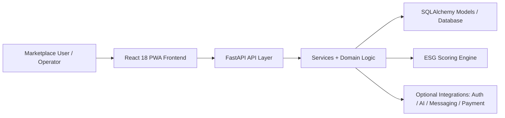

# Worldmine

[](https://www.python.org/downloads/)
[](https://fastapi.tiangolo.com/)
[](https://react.dev/)
[](https://www.typescriptlang.org/)
[](https://www.postgresql.org/)
[](LICENSE)

Worldmine is an industrial mineral commerce and operational intelligence platform designed for trust, traceability, and execution. It combines a high-performance FastAPI backend, SQLAlchemy-backed persistence, deterministic ESG scoring, and a React 18 PWA frontend to support mineral trading, provenance tracking, asset operations, and decision support in a production-oriented architecture.

## Executive Summary

The platform addresses a fragmented physical commodities market where trust, provenance, and operational visibility are often weak. Worldmine centralizes the core capabilities needed for mineral and gemstone commerce:

- Listing and marketplace workflows
- Escrow and transactional orchestration
- Logistics and contract lifecycle support
- ESG and carbon-neutral verification
- Satellite-informed provenance and traceability signals
- AI-assisted operational intelligence for governance, negotiation, and monitoring

The system is designed to run as a cohesive deployable product while keeping business logic explicit, testable, and increasingly production-ready.

## Key Architecture Highlights

- FastAPI service layer with structured API routing and OpenAPI-driven integration points
- Deterministic ESG carbon scoring and certificate generation
- Hermetic SQLite/PostgreSQL-backed testing model for reliable local verification
- SQLAlchemy ORM schema with modular service boundaries and persistence-driven workflows
- React 18 PWA frontend with a modular UI and production-oriented deployment path
- Optional integrations for auth, notifications, AI services, and external infrastructure

## Solution Architecture



## Tech Stack

| Layer | Technology | Purpose |
|---|---|---|
| Backend | Python 3.11+, FastAPI, Uvicorn | API service and application runtime |
| Persistence | SQLAlchemy, SQLite, PostgreSQL | Data modeling and durable state |
| Auth & Security | JWT, bcrypt, CORS policy controls | Identity, security, and access boundaries |
| Frontend | React 18, TypeScript, Vite, PWA | Browser experience and operational tooling |
| Data / Intelligence | ESG scoring, provenance logic, analytics services | Business-grade operational intelligence |
| DevOps | Docker, GitHub Actions, pytest | Delivery, automation, and validation |
| Optional Integrations | Redis, Supabase, SendGrid, AI providers | Extended services and production ecosystem hooks |

## Core System Modules

- Marketplace and listing management
- Escrow, payment, and trade orchestration
- Contract and logistics workflows
- ESG scoring and carbon-neutral certificate generation
- Authentication and authorization flows
- Mineral news and operational intelligence modules
- Provisional traceability and satellite-informed verification
- Admin and governance surfaces

## Repository Layout

```text
.
├── app.py                     # FastAPI application entry point
├── database.py               # Database setup and initialization
├── models.py                 # SQLAlchemy schema definitions
├── requirements.txt          # Python dependencies
├── .env.example              # Template environment configuration
├── tests/                    # Backend pytest suite
├── web-client/               # React 18 frontend application
├── backend/                  # API modules and service wiring
├── services/                 # Business logic and platform services
├── core/                     # Cross-cutting runtime systems
├── docs/                     # Product documentation and operational notes
├── ai-agent/                 # Agentic market intelligence workflows
├── dashboard/                # Operational dashboard tooling
├── README.md                 # Product overview and usage guide
└── LICENSE                   # Add a license for formal reuse/distribution terms
```

## Local Setup

### Prerequisites

- Python 3.11+
- Node.js 18+
- PostgreSQL optional for production-like environments
- SQLite works for local-first verification and hermetic testing

### 1. Clone and set up the environment

```bash
git clone https://github.com/Dan12-dev-ai/worldmine.git
cd worldmine
python3 -m venv .venv
source .venv/bin/activate
pip install -r requirements.txt
```

### 2. Initialize the database

```bash
DATABASE_URL=sqlite:///./worldmine.db python3 -c "from database import init_db; init_db()"
```

### 3. Run the backend

```bash
DATABASE_URL=sqlite:///./worldmine.db python3 -m uvicorn app:app --host 127.0.0.1 --port 8000
```

### 4. Run the frontend

```bash
cd web-client
npm install
npm run dev
```

The frontend development server typically runs on http://localhost:5173 and proxies API traffic to the backend.

## Environment Configuration

Create a local `.env` file from the repository template and fill in values appropriate to your environment.

```bash
cp .env.example .env
```

Key configuration variables include:

- `DATABASE_URL` — SQLite or PostgreSQL database connection string
- `JWT_SECRET` — signing key for API authentication
- `PRODUCTION_URL` — production origin used in CORS and deployment config
- `ENVIRONMENT` — development or production runtime mode
- `REDIS_HOST`, `REDIS_PORT`, `REDIS_URL` — optional Redis integration
- `SUPABASE_URL`, `SUPABASE_SERVICE_ROLE_KEY` — optional Supabase integration
- `SENDGRID_API_KEY` — optional email integration
- `DEBUG` — local debugging behavior for SQLAlchemy and logging

## Testing

Worldmine is designed to be validated with a hermetic, reproducible test model. The project includes pytest-based backend testing, frontend type checking, and production-oriented QA patterns.

### Backend tests

```bash
python3 -m pytest tests
```

### ESG regression checks

```bash
python3 -m pytest tests/unit/backend/test_esg_auditor.py
```

### Frontend type check

```bash
cd web-client
npx tsc --noEmit
```

### Frontend production build

```bash
cd web-client
npm run build
```

## Local Verification

Once the backend is running, the following checks are useful for a quick smoke test:

```bash
curl -s http://127.0.0.1:8000/health
curl -s http://127.0.0.1:8000/docs
curl -s 'http://127.0.0.1:8000/api/marketplace/listings?page=1&page_size=20'
```

These checks validate that the service is reachable and that the core API surfaces are being served correctly.

## Production Readiness Notes

Worldmine is structured to support a production-oriented operating model, but several areas remain intentionally modular and integration-dependent. A strong engineering posture requires:

- explicit environment management
- durable persistence strategy and migration discipline
- secure secret management
- real integration testing for external providers
- continuous CI validation and deployment guardrails

## License

This repository does not currently include a formal LICENSE file. For open-source reuse or redistribution, a license should be added to define usage and contribution terms. Until then, the project should be treated as intentionally unlicensed unless otherwise specified by the repository owner.

## Project Status

This project is actively developed as a platform prototype and production-oriented foundation. It already demonstrates substantial system composition, API surface breadth, and architectural clarity, with emphasis on reliability, traceability, and operational intelligence.

---

Worldmine is designed to be more than a demo: it is a platform foundation for mineral commerce infrastructure, market trust, and operational insight in a sector where accountability and transparency matter.
