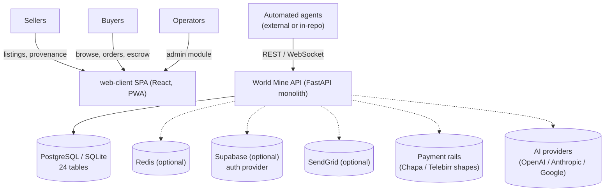

# Architecture

This document describes the architecture **as built and verified** in this repository, not an aspirational target. Where a subsystem is mocked or degraded, it says so.

## 1. System context

World Mine is a marketplace for minerals and gemstones. Its users are sellers (mines, traders), buyers, marketplace operators (admins), and automated agents. It integrates with external systems only optionally: a database (PostgreSQL/SQLite), Redis, Supabase (auth), SendGrid (email), payment providers (Chapa/Telebirr shapes), and AI providers.



## 2. Components and responsibilities

| Component | Location | Responsibility |
|---|---|---|
| Application factory & inline routers | `app.py` | Creates the FastAPI app; middleware (CORS, GZip, TrustedHost); ~50 inline endpoints under `/api/v3/*` and `/api/v4/*` (sovereign auth, ESG, tax, conflict, insurance, satellite, video, traceability); lifespan wiring of `app.state` services |
| Router layer | `backend/api/` (16 routers, ~150 endpoints) | HTTP contracts: validation, status codes, delegation to services. Prefixes: `/api/marketplace`, `/api/wallet`, `/api/escrow`, `/api/contracts`, `/api/logistics`, `/api/payment`, `/api/trading`, `/api/v2/mineral-news`, `/api/ai-*`, `/api/admin`, `/api/notifications`, plus a WebSocket gateway |
| Services layer | `services/` | Business logic: marketplace listings, ESG scoring (`esg/` + `esg_auditor.py`), video negotiation, IoT sensors, ECX compliance, sovereign onboarding, tax oracle, micro-insurance, satellite transactions, guardian vault, messaging event bus, quantum-shaped encryption |
| Core platform | `core/` | Cross-cutting systems: unified state manager, sovereign auth, conflict prevention, event-driven architecture, health monitor, reliability system, governance orchestrator, agent intercept/advisory layers |
| Persistence | `models.py`, `database.py` | 24 SQLAlchemy tables; engine from `DATABASE_URL`; `get_db()` dependency; `init_db()`/`drop_db()` |
| In-memory stores | inside `backend/api/*.py` | Escrow, contracts, logistics, notifications, admin stats, trading hold state in **module-level dicts** — functional but non-durable |
| Frontend SPA | `web-client/` | React 18 + TS + Vite PWA: public pages, marketplace, mineral detail, auth, 8-module authenticated workspace, admin; design system in `src/design-system/`; typed API client in `src/shared/api/` |
| Tests | `tests/`, `conftest.py` | pytest suite; in-memory SQLite `TestClient` fixture; `staging` marker for live-infra tests |

## 3. Request lifecycle

```mermaid
sequenceDiagram
    participant B as Browser (web-client)
    participant M as Middleware (CORS/GZip)
    participant R as Router (backend/api or app.py)
    participant S as Service (services/ / core/)
    participant D as Database (SQLAlchemy)

    B->>M: GET /api/marketplace/listings
    M->>R: origin check, decompression
    R->>R: validate query params (Pydantic)
    R->>S: ListingService.listings(...)
    S->>D: SELECT ... LIMIT/OFFSET
    D-->>S: rows
    S-->>R: {data, total, page,...}
    R-->>B: 200 JSON envelope
    Note over R,S: On missing tables or DB errors the service<br/>raises and the router returns 5xx; inline<br/>handlers catch and return {"success": false}
```


## 4. Data flow and ownership

- **Database-backed (24 tables in `models.py`):** users, listings, auctions, bids, buy-it-now transactions, traceability records, esg_metrics, compliance_records, ai_agents, agent_actions, video_sessions, trust_signals, bulk_orders, user_guardians, market_agents, agent_rentals, unified_sessions, feature_execution_logs, insurance_policies, satellite_verifications, wallets, transactions.
- **In-memory (lost on restart):** escrow records, contracts, shipments, notifications, admin dashboard stats, trading session state. The corresponding frontend screens label this explicitly.
- **Derived/deterministic:** ESG scores are computed from listing coordinates with documented mock formulas (`services/esg_auditor.py`); unit tests pin the exact values (e.g. lat 9.0/lon 38.0 → overall 83.9, `carbon_aware`).

## 5. External integrations

Optional integrations are **import-guarded**: `app.py` wraps optional imports (Supabase news agent, autonomous trading agent) in `try/except` and affected endpoints return **503** when a dependency is absent, so the process always boots. By contrast `backend/api/auth.py` requires Supabase, Redis, and SendGrid **at import time** — it is only safe to mount when those packages and credentials exist.

## 6. Failure handling

- Routers translate exceptions to HTTP errors; inline endpoints catch, log, and return `{"success": false, "error": ...}`.
- `core/reliability_system.py` plus `backend/api/reliability_middleware.py` add reliability middleware (rate limiting, structured errors).
- Health probes: `/health` and `/api/health` touch no dependencies — safe for liveness/readiness checks.

## 7. Deployment boundaries

One backend process (Uvicorn) behind the platform edge, plus a static frontend (Vercel). `render.yaml` defines the API service with a `/health` health check. Celery/Kafka/Elasticsearch clients appear in `requirements.txt`, but **no worker topology, broker, or search cluster is defined or deployed** in the verified architecture — they are library installs, not running systems.

## 8. Known architectural constraints (verified)

1. **Durability gap** — money-adjacent state (escrow, contracts) lives in process memory. The single largest correctness risk in the system.
2. **Two response conventions** (data envelope vs. success flag) complicate client typing and API consistency.
3. **Auth mounting is all-or-nothing** — `backend/api/auth.py` hard-requires its integrations at import time.
4. **Monolith by design** — clear router/service/core layering, but no enforced dependency-direction tooling (no import-linter; CI does not gate layering).
5. **Version drift** — `/health` reports `2.0.0` while the FastAPI app declares `3.0.0`.
6. **CI/tree mismatch** — `.github/workflows/ci-cd.yml` assumes a root npm project that does not exist (see [testing.md](testing.md)).

Related: [project-structure.md](project-structure.md) · [testing.md](testing.md) · [adr/README.md](adr/README.md)

Two response styles coexist and both appear in the API: **FastAPI-native** envelopes (`{"data": [...], "total": n, ...}` in routers) and **legacy success-flag** payloads (`{"success": true/false, ...}` in the inline `/api/v3`, `/api/v4` endpoints). The frontend mirrors this in `src/shared/types/domain.ts`.
